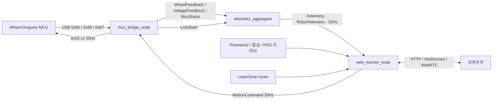

# 차량 ROS 2 워크스페이스

이 워크스페이스는 차체 모델·센서 bringup, MCU 피드백 수집, 브라우저 영상·차량 상태 조회를 제공한다. 문서는 현재 소스 구현을 설명하며, 실행·빌드 성공을 보증하는 검증 보고서가 아니다.

MCU 브리지는 피드백 수신과 `MotionCommand`의 `0x03 v1` 송신을 지원한다. 웹은 RC AUTO에서 키보드·가상 조이스틱으로 일반 v·θ 또는 PIVOT ω를 요청한다. `/cmd_vel` 변환과 휠 오도메트리 발행은 구현하지 않는다.

## 구성

| 패키지 | 역할 | 빌드 방식 |
| --- | --- | --- |
| [`my_car_package`](src/my_car_package) | 차체 URDF/Xacro·메시, TF, RViz, 센서·모터 통합 bringup 및 bag/SLAM 실험 launch | `ament_cmake` |
| [`my_car_mcu_bridge`](src/my_car_mcu_bridge/README.md) | `0x85/86/87` 피드백 수신, 0x03 명령 송신 및 20Hz 집계 | `ament_python` |
| [`my_car_web_monitor`](src/my_car_web_monitor/README.md) | FastAPI 웹 UI, WebRTC 영상, LiDAR·차량 상태 조회와 수동 제어 | `ament_python` |
| [`my_car_interfaces`](src/my_car_interfaces/README.md) | 피드백·상태·집계 전용 ROS 메시지 | `ament_cmake` / rosidl |

```text
ros2_ws/
├── src/
│   ├── my_car_interfaces/
│   ├── my_car_package/
│   ├── my_car_mcu_bridge/
│   ├── my_car_web_monitor/
│   └── camera_ros/         # 별도로 클론한 외부 카메라 드라이버 (Git 추적 제외)
├── agent/                  # 개발 계획 및 작업 보고서
├── build/                  # colcon 빌드 산출물
├── install/                # 설치된 패키지와 환경 설정
└── log/                    # colcon 로그
```

`build/`, `install/`, `log/`의 내용은 Git 추적에서 제외된다. 다른 장비에서는 소스로부터 다시 빌드한다.

## 외부 센서 패키지

Raspberry Pi 카메라 등 libcamera 지원 카메라의 영상을 ROS 이미지 토픽으로 발행하기 위해 [`camera_ros`](https://github.com/christianrauch/camera_ros)를 `src/camera_ros/`에 별도로 클론해 사용한다. 이 디렉토리는 `.gitignore`로 추적에서 제외하므로, 이 저장소를 클론한 다른 장비에서는 아래 명령으로 추가해야 한다. Git ignore 여부와 관계없이 `colcon`은 해당 패키지를 발견하고 함께 빌드한다.

```bash
git clone https://github.com/christianrauch/camera_ros.git src/camera_ros
```

`camera_ros`는 `ament_cmake` 패키지이며 libcamera 0.1 이상이 필요하다. 기본적으로 아래 `rosdep install` 명령으로 의존성을 설치한다. 시스템에 설치된 libcamera를 사용하는 경우에는 `--skip-keys=libcamera`를 추가한다. 카메라 모듈에 맞는 libcamera 설치·빌드 방법은 [업스트림 README](https://github.com/christianrauch/camera_ros#build-instructions)를 참고한다.

T265와 YDLidar X4-Pro 드라이버는 별도 센서 워크스페이스의 `../../robot_ws/ros2_ws/src/`에서 관리한다. 이 저장소로 소스를 복사하지 않고, 빌드된 센서 환경을 먼저 불러와 함께 사용한다.

| 센서 / 패키지 | 역할 | 현재 구성 |
| --- | --- | --- |
| Intel RealSense T265 / `realsense2_camera` | 추정 위치·자세를 `/camera/pose/sample`로 발행하고 관련 TF 제공 | `realsense-ros` 4.0.4 기반, 로컬 소스 수정 포함. 해당 README의 librealsense 지원 버전은 `2.50.0` |
| YDLidar X4-Pro / `ydlidar_ros2_driver` | 2D 거리 스캔을 `/scan`으로 발행 | 외부 `ydlidar_sdk` 필요. launch와 기본 YAML에 로컬 수정 포함 |

RealSense 저장소에는 메시지 패키지 `realsense2_camera_msgs`와 모델 패키지 `realsense2_description`도 포함된다. X4-Pro 설정은 드라이버의 `params/X4-Pro.yaml`에 있으며, 현재 `params/ydlidar.yaml`에도 같은 장비 설정이 적용되어 있다. 주요 값은 포트 `/dev/ttyUSB0`, baudrate `128000`, 프레임 `laser_frame`이다.

T265와 X4-Pro 센서 드라이버는 기존 워크스페이스에서 유지하고, 센서·모터 통합 실행은 이 워크스페이스의 `my_car_package/launch/bringup.launch.py`에서 관리한다. 다른 장비에 환경을 재현할 때는 드라이버 버전뿐 아니라 로컬 수정과 SDK 버전도 함께 보존해야 한다.

기존 센서 워크스페이스의 `my_car_bringup`은 `my_car_description` 모델을 함께 실행하고, `bringup.launch.py`는 SLAM도 실행한다. 현재 `my_car_package` 모델 launch와 함께 실행하면 차체 TF를 중복 발행할 수 있으므로, 아래 예제에서는 센서 드라이버만 각각 실행한다.

## 데이터 흐름



브리지는 검증·디코딩한 패킷마다 즉시 발행한다. 집계 노드는 각 스트림의 최신값과 수신 여부·경과시간을 묶는다. 네 휠과 전압은 비동기 데이터이며 집계 메시지는 동시 측정 스냅샷이 아니다. ROS 내부에서는 전용 메시지를 사용하고 웹 경계에서 JSON으로 변환한다.

패킷·오류 의미는 [MCU 브리지 문서](src/my_car_mcu_bridge/README.md), 필드·단위는 [인터페이스 문서](src/my_car_interfaces/README.md)를 참고한다.

## 환경 준비 및 빌드

ROS 2, ROS 환경과 호환되는 시스템 Python, `colcon`, `rosdep`, `uv`가 필요하다. 저장소에서 특정 ROS 2 배포판을 고정하지 않으므로 설치된 ROS 환경을 먼저 불러온다.

**명령은 별도 안내가 없으면 이 README가 있는 워크스페이스 루트에서 실행한다.** 상대 경로는 다음 개발 환경 배치를 기준으로 한다. 다른 배치에서는 외부 워크스페이스를 가리키는 경로를 조정한다.

```text
공통 상위 디렉터리/
├── ros2_ws/                # ROS 2 기본 환경: ../../ros2_ws
├── robot_ws/ros2_ws/       # 센서 환경: ../../robot_ws/ros2_ws
└── car_ws/ros2_ws/         # 현재 워크스페이스: .
```

```bash
source ../../ros2_ws/install/setup.bash
# 일반적인 바이너리 설치 환경에서는 위 명령 대신 사용:
# source /opt/ros/<배포판>/setup.bash

# 센서를 함께 사용할 때 추가 (센서 워크스페이스가 빌드되어 있어야 함)
source ../../robot_ws/ros2_ws/install/local_setup.bash

rosdep install --from-paths src --ignore-src -r -y
```

외부 환경은 ROS 기본 환경 → 센서 환경 → 현재 워크스페이스 순서로 불러온다. `local_setup.bash`는 해당 워크스페이스 환경만 추가하므로, 앞 단계 환경을 명시적으로 불러온 후 사용한다. 기존 `install/setup.bash`에는 과거 빌드의 외부 경로가 저장될 수 있어 아래 실행 예제도 이 순서를 사용한다.

`rosdep`은 초기화 및 인덱스 갱신이 되어 있어야 한다. 웹/영상 Python 의존성은 별도로 가상환경에 설치한다. `rclpy`의 바이너리 호환성을 위해 ROS가 사용하는 시스템 Python과 시스템 패키지 접근을 유지한다.

```bash
cd src/my_car_web_monitor
uv venv --python /usr/bin/python3 --system-site-packages
source .venv/bin/activate
uv sync --active

cd ../..
python -m colcon build --symlink-install
source install/local_setup.bash
```

가상환경의 Python으로 `python -m colcon`을 실행해야 웹 실행 스크립트가 같은 Python을 사용한다. `colcon` Python 모듈도 이 환경에서 접근 가능해야 한다. 웹 실행 시 `uvicorn` 등을 찾지 못하면 다음 명령으로 실행 스크립트의 Python 경로를 확인하고, 가상환경을 활성화한 상태에서 다시 빌드한다.

```bash
head -1 install/my_car_web_monitor/lib/my_car_web_monitor/web_monitor_node
```

웹 기능이 필요 없다면 가상환경 설정 없이 ROS 환경에서 필요한 패키지만 빌드할 수 있다.

```bash
colcon build --symlink-install --packages-up-to my_car_package my_car_mcu_bridge
source install/local_setup.bash
```

## 실행

새 터미널마다 ROS 환경과 이 워크스페이스를 불러온다. 웹 실행에는 가상환경도 활성화한다.

```bash
source ../../ros2_ws/install/setup.bash
# 센서 사용 시 추가
source ../../robot_ws/ros2_ws/install/local_setup.bash
source src/my_car_web_monitor/.venv/bin/activate
source install/local_setup.bash
```

### 센서·모터 통합 실행 (bringup)

[`bringup.launch.py`](src/my_car_package/launch/bringup.launch.py)는 전·후방 Raspberry Pi 카메라, YDLidar, T265, MCU 모터 브리지를 한 번에 실행한다. 앞의 환경 준비 및 빌드 절차를 완료하고, 센서 워크스페이스와 현재 워크스페이스 환경을 모두 불러온 상태에서 실행한다. launch를 새로 추가한 뒤에는 `my_car_package`를 다시 빌드한다.

```bash
colcon build --symlink-install --packages-select my_car_package
source install/local_setup.bash
ros2 launch my_car_package bringup.launch.py
```

| 구성 요소 | 포함하는 launch | 적용 설정 |
| --- | --- | --- |
| 전·후방 카메라 | `my_car_package/rpi_cameras.launch.py` | `launch/yaml/cameras.yaml` 사용, `/front_camera/image_raw`·`/rear_camera/image_raw` 발행 |
| YDLidar X4-Pro | `ydlidar_ros2_driver/ydlidar_launch.py` | 드라이버 기본 `params/ydlidar.yaml` 사용. `X4-Pro.yaml`을 직접 지정하지 않음 |
| T265 | `realsense2_camera/rs_launch.py` | `device_type:=t265`, `enable_accel:=true`, `enable_gyro:=true` 전달 |
| 모터 브리지 | `my_car_mcu_bridge/mcu_bridge.launch.py` | `config/mcu_bridge.yaml` 및 하위 launch의 기본값 사용 |

`camera_ros`, `ydlidar_ros2_driver`, `realsense2_camera`, `my_car_mcu_bridge`가 실행 환경에서 검색되어야 하며, 연결한 장치에 맞게 카메라 인덱스와 시리얼 포트 설정을 확인한다. 현재 bringup에는 구성 요소별 실행 여부를 선택하는 인자가 없으므로, 일부만 실행하려면 아래 개별 실행 명령을 사용한다. 이미 실행 중인 동일 드라이버나 모터 브리지는 중복 실행하지 않는다.

웹 모니터, 차체 모델·TF, RViz, SLAM은 별도로 실행한다. bringup 실행 후 별도 터미널에 동일한 환경을 불러오고 웹 모니터를 연결할 수 있다.

```bash
CAMERA_STREAMS=front:ros_image:/front_camera/image_raw,rear:ros_image:/rear_camera/image_raw,t265_1:ros_image:/camera/fisheye1/image_raw,t265_2:ros_image:/camera/fisheye2/image_raw \
  ros2 run my_car_web_monitor web_monitor_node
```

브라우저에서 `http://<실행 장비 IP>:8443`에 접속하면 전·후방 영상과 모터 상태를 확인할 수 있다. 차체 모델은 아래 `description.launch.py` 또는 `display.launch.py` 중 하나로 실행한다.

### 카메라·MCU 없이 웹 화면 확인

```bash
CAMERA_SOURCE=synthetic ros2 run my_car_web_monitor web_monitor_node
```

브라우저에서 `http://localhost:8443` 또는 `http://<실행 장비 IP>:8443`에 접속한다. 기본 포트는 8443이지만 현재 서버는 **HTTP**로 실행된다. 합성 영상은 카메라만 대체하며 ROS 환경은 필요하다. 모터 브리지를 실행하지 않아도 웹 화면과 영상을 확인할 수 있고, 모터 상태는 수신 대기 상태로 남는다.

### MCU 피드백 수신

```bash
ros2 launch my_car_mcu_bridge mcu_bridge.launch.py
```

수신 노드와 집계 노드를 함께 실행한다. 기본 포트 `/dev/ttyACM0`, baudrate `115200`, 읽기 타이머 `100Hz`는 [mcu_bridge.yaml](src/my_car_mcu_bridge/config/mcu_bridge.yaml)에서 설정한다. 패킷 발행 주기는 읽기 타이머 주기가 아니라 실제 수신에 따른다.

노드 하나씩 실행하려면 launch 대신 별도 터미널에서 다음을 사용한다.

```bash
ros2 run my_car_mcu_bridge mcu_bridge_node --ros-args -p port:=/dev/ttyACM1
```

```bash
ros2 run my_car_mcu_bridge telemetry_aggregator
```

조회 예시:

```bash
ros2 topic echo /telemetry
```

시리얼 포트는 브리지 하나가 소유한다. 브리지는 활성 명령이 있고 최신 CONTROL 피드백이 유효하면 정상 종료 시 enable=0을 한 번 시도한다. 단절 중 포트를 다시 열어 정지 명령을 보내지는 않는다. MCU가 BRIDGE 모드이면 이 ROS 노드가 CONTROL로 복귀시키지 않으며, 일반 피드백을 받으려면 MCU가 CONTROL이어야 한다. 구형 프로토콜 fallback과 CAN 진단 요청 인터페이스는 없다.

### Raspberry Pi 카메라

[`rpi_cameras.launch.py`](src/my_car_package/launch/rpi_cameras.launch.py)는 `camera_ros`의 `camera_node` 두 개를 `front_camera`, `rear_camera`라는 이름으로 실행한다. 웹 모니터는 각 카메라의 ROS 이미지 토픽을 구독한다. launch와 설정 파일을 추가하거나 수정한 뒤에는 패키지를 다시 빌드하고 환경을 불러온다.

```bash
colcon build --symlink-install --packages-select my_car_package
source install/local_setup.bash
```

`camera_ros`도 앞의 환경 준비 및 빌드 절차에 따라 빌드되어 있어야 한다. 아래 명령은 각각 별도 터미널에서 실행한다.

```bash
# 터미널 1: 전·후방 카메라 드라이버
ros2 launch my_car_package rpi_cameras.launch.py

# 터미널 2: 전·후방 이미지 토픽을 웹에 연결
CAMERA_STREAMS=front:ros_image:/front_camera/image_raw,rear:ros_image:/rear_camera/image_raw \
  ros2 run my_car_web_monitor web_monitor_node
```

카메라 설정은 [`launch/yaml/cameras.yaml`](src/my_car_package/launch/yaml/cameras.yaml)에서 관리한다. 현재 전방은 카메라 인덱스 `1`, 후방은 `0`이며, 두 카메라 모두 센서 모드 `2028:1520`, 출력 해상도 `640×480`, 형식 `RGB888`, 자동 노출을 사용한다. `FrameDurationLimits`는 `[41666, 50000]` µs로 설정되어 약 20~24 FPS 범위에 해당한다. 카메라 인덱스와 센서 모드는 연결한 장비에 맞게 조정한다.

```bash
ros2 topic hz /front_camera/image_raw
ros2 topic hz /rear_camera/image_raw
```

Picamera2 직접 연결 방식도 지원하며, 동일한 카메라를 사용하는 드라이버와 동시에 실행하지 않는다.

시스템 카메라 스택과 Picamera2를 설치한 장비에서 실행한다. Picamera2는 `uv` 의존성에 포함되어 있지 않다.

```bash
# 기본: 카메라 0
ros2 run my_car_web_monitor web_monitor_node

# 카메라 두 대
CAMERA_STREAMS=front:picamera2:0,rear:picamera2:1 \
  ros2 run my_car_web_monitor web_monitor_node
```

### 차체 모델 시각화

```bash
# TF와 robot_description 발행
ros2 launch my_car_package description.launch.py

# 모델 발행과 RViz를 함께 실행하려면 위 명령 대신 사용
ros2 launch my_car_package display.launch.py
```

모델에는 `camera_link`, `base_link`, `laser_frame`이 정의되어 있다. 모델 launch는 카메라·LiDAR 드라이버를 실행하지 않는다.

### T265와 YDLidar X4-Pro

위 환경 설정을 적용한 터미널에서 각 센서를 실행한다. 각 명령은 별도 터미널에서 실행한다.

```bash
ros2 launch realsense2_camera rs_launch.py device_type:=t265
```

```bash
ros2 launch ydlidar_ros2_driver ydlidar_launch.py \
  params_file:=../../robot_ws/ros2_ws/src/ydlidar_ros2_driver/params/X4-Pro.yaml
```

별도 터미널에서 센서 토픽을 확인한다.

```bash
ros2 topic hz /camera/pose/sample
# 위 명령을 종료한 뒤 실행
ros2 topic hz /scan
```

차체 모델이 필요하면 `my_car_package`의 모델 launch 하나를 함께 실행한다. SLAM에는 센서 토픽뿐 아니라 일관된 TF 연결이 필요하다. 저장소의 SLAM 설정은 `odom_frame`, `base_link`, `/scan`을 사용하므로 T265의 TF와 차체 모델 사이 연결도 확인해야 한다.

### ROS 이미지 토픽을 웹에서 보기

T265 드라이버를 실행한 상태에서 웹 노드에 Fisheye 토픽을 등록한다. 토픽 이름은 센서의 namespace 설정에 따라 달라질 수 있으므로 `ros2 topic list -t`로 확인한다.

```bash
CAMERA_STREAMS=left:ros_image:/camera/fisheye1/image_raw,right:ros_image:/camera/fisheye2/image_raw \
  ros2 run my_car_web_monitor web_monitor_node
```

Picamera2와 함께 등록할 수도 있다.

```bash
CAMERA_STREAMS=front:picamera2:0,left:ros_image:/camera/fisheye1/image_raw,right:ros_image:/camera/fisheye2/image_raw \
  ros2 run my_car_web_monitor web_monitor_node
```

브라우저에는 기존 카메라와 동일한 스트림 카드가 생성된다. 시작하면 토픽을 구독하고, 마지막 시청자가 연결을 종료하면 구독을 해제한다. `ros_image`는 `sensor_msgs/msg/Image`, `ros_compressed`는 `sensor_msgs/msg/CompressedImage`를 받는다. 압축 토픽이 실제 발행 중이라면 `left:ros_compressed:/camera/fisheye1/image_raw/compressed`처럼 지정한다.

T265의 `mono8`을 비롯해 `8UC1`, `rgb8`, `bgr8`, `rgba8`, `bgra8`과 JPEG/PNG 압축 영상을 지원한다. 깊이 영상과 그 외 인코딩은 지원하지 않는다. ROS 영상은 원본 해상도를 유지하며 `CAMERA_FPS` 속도로 최신 영상을 전송한다. 첫 이미지 전에는 대기하고, 센서 발행이 중단되면 마지막 정상 이미지가 반복되므로 정지 화면만으로 센서 수신 상태를 판단하지 않는다. 상세 동작은 [웹 패키지 문서](src/my_car_web_monitor/README.md)를 참고한다.

## 웹 설정과 인터페이스

환경변수로 설정한다. 기본 주소는 `http://<장비 IP>:8443`이며 TLS 설정은 없다. `MOTOR_STATUS_TOPIC`의 기본값은 `/telemetry`, 타입은 `my_car_interfaces/msg/RobotTelemetry`다. 카메라·WebRTC·HTTP/WS 설정과 UI 정보는 [웹 문서](src/my_car_web_monitor/README.md)를 참고한다.

`/ws/status`는 읽기 전용이다. `/ws/control`은 RC 모드와 무관하게 연결을 유지하는 단일 제어 세션이다. AUTO 외에는 0·disable을 발행하고 최신 MCU 피드백에서 AUTO를 확인하면 현재 입력·enable을 발행한다. 일반 모드 A/D는 조향 11단계를 선택하며 키 해제 후 유지한다. P와 UI 버튼은 키·드래그가 없을 때 입력 초기화 → 기존 모드 정지 지령 → 갱신된 적용 속도 0 확인 → 모드 전환 순서로 동작한다. 상세 조작·입력 만료 규칙은 웹 문서를 따른다.

## rosbag 및 SLAM 실험

[`my_car_package/launch`](src/my_car_package/launch)의 SLAM 관련 파일은 개발 환경에 맞춘 실험용 구성이다. bag 데이터와 외부 설정 파일을 준비하고 경로를 수정해야 한다. 사용하는 구성에 따라 `tf2_ros`, `rosbag2`, `slam_toolbox` 및 bag 저장 형식 플러그인이 추가로 필요하며, 모든 의존성이 현재 `package.xml`에 선언되어 있지는 않다.

| launch 파일 | 현재 동작 및 준비 사항 |
| --- | --- |
| `play_bag_env.launch.py` | 모델·보조 TF와 선택적 RViz 실행. bag 재생은 별도로 실행 |
| `offline_slam.launch.py` | bag 재생 + SLAM Toolbox 동기 온라인 launch. `/root/my_offline_params.yaml` 필요 |
| `record_slam_with_bag.launch.py` | bag 재생 + SLAM Toolbox. `/root/slam_toolbox.yaml` 필요. 이름과 달리 녹화 프로세스는 실행 목록에서 주석 처리됨 |

bag 재생 launch에는 `bag_file`, `play_speed`(기본 `0.1`), `use_rviz`(기본 `false`) 인자가 있다. SLAM launch의 RViz 경로는 `/root/.rviz2/Map_TF_RM_LS.rviz`로 고정되어 있다. 저장소의 [`slam_toolbox.yaml`](src/my_car_package/launch/yaml/slam_toolbox.yaml)은 현재 launch에서 자동 참조하지 않는다.

위 `/root/...` 경로는 현재 코드에 고정된 값을 설명하기 위해 그대로 표기했다. 실제 사용 전에 환경에 맞게 launch를 수정해야 한다. `/dev/...` 장치 경로와 `/usr/bin/python3` 시스템 실행 파일 경로도 절대 경로를 유지한다.

`description.launch.py`는 전달받은 `use_sim_time`을 노드 파라미터에 반영하지 않으므로, bag 시간 기반으로 확장할 때 이 부분도 확인해야 한다.

## 검증 상태와 문서

현재 split telemetry 구현과 UI에 대한 빌드·테스트·실물 통신 검증은 이 문서 정리 작업에서 수행하지 않았다. 기존 웹 테스트에는 구형 상태·제어 전제를 사용하는 항목이 남아 있으므로 현행 규격 검증으로 간주하지 않는다. 구형 MCU 테스트는 `agent/archive/pre_split_telemetry/`에 보관되어 있다.

- [MCU 브리지: 프로토콜·토픽·집계·설정](src/my_car_mcu_bridge/README.md)
- [전용 메시지 필드·단위](src/my_car_interfaces/README.md)
- [웹 모니터: 설정·영상·상태 표시](src/my_car_web_monitor/README.md)
- [개발 문서 안내 및 과거 기록](agent/README.md)
